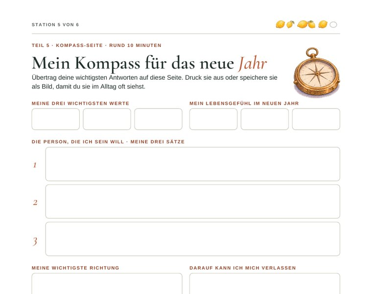
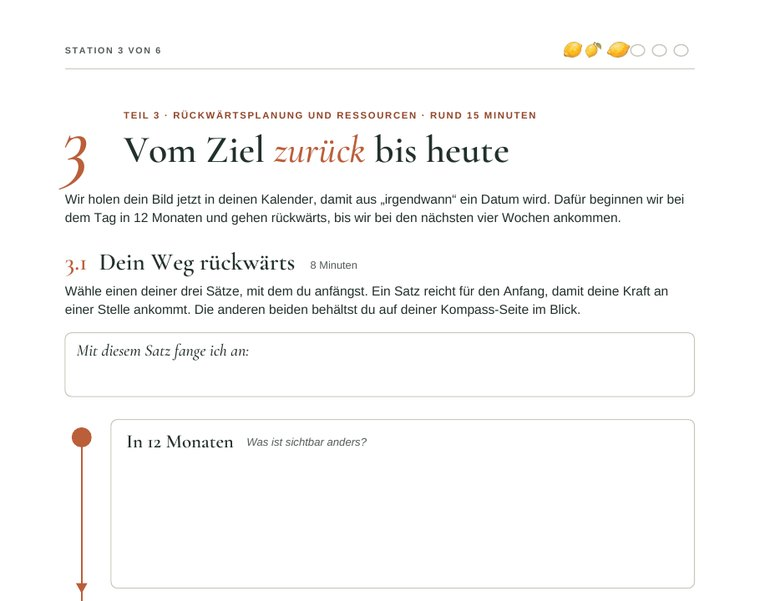

Ende des Jahres ist für viele von uns eine merkwürdige Zeit. Der Kalender ist voll, im Kopf läuft schon das nächste Jahr, und irgendwo dazwischen meldet sich die Frage, was dieses Jahr eigentlich mit dir gemacht hat. Und ob das nächste anders werden soll.

Viele beantworten das mit einer Liste guter Vorsätze. Im Februar ist davon meist nicht mehr viel übrig. Ein persönlicher Jahresrückblick geht einen anderen Weg: Du schaust ehrlich zurück, damit du klarer siehst, wohin du willst, und du endest mit einem Schritt, der in deinen Alltag passt.

Hier findest du die Fragen, mit denen das gelingt.

## Bevor du anfängst

Nimm dir zwei oder drei ruhige Abende, oder einen, wenn er lang genug ist. Leg dir deinen Kalender und dein Handy bereit. Die Fotos der letzten zwölf Monate erinnern dich an mehr, als du gerade im Kopf hast.

Schreib mit der Hand oder tippe, beides funktioniert. Wichtig ist nur, dass du deine Antworten aufschreibst. Was nur im Kopf bleibt, ist am nächsten Morgen oft schon wieder weg.

## Teil 1: Fragen für deinen Rückblick

Fang mit dem Blick zurück an. Er zeigt dir, worauf du im nächsten Jahr aufbauen kannst.

**Wie zufrieden bist du gerade mit den einzelnen Bereichen deines Lebens?** Bewerte Bereiche wie Gesundheit, Beziehungen, Beruf, Finanzen und Freizeit jeweils von 1 bis 10. Schreib zu den zwei höchsten und den zwei niedrigsten Werten je einen Satz, was dahintersteht. Dieses Bild heißt Lebensrad, und es zeigt dir auf einen Blick, wo sich am meisten bewegen soll.

*So sieht das Lebensrad im kostenlosen Journal aus.*

**Was ist in welchem Monat passiert?** Geh Monat für Monat durch und notiere zu jedem ein Ereignis, das dir im Gedächtnis geblieben ist. So bekommen auch die Monate Platz, die schon weit weg wirken.

**Was hat dir Kraft gegeben, und was hat dich Kraft gekostet?** Schreib je drei Menschen, Orte oder Tätigkeiten auf. Diese beiden Listen sind später Gold wert, wenn du entscheidest, wovon du im nächsten Jahr mehr und wovon du weniger willst.

**Wann ging es dir gut?** Denk an einen Moment, in dem du etwas selbst entschieden hast, obwohl es bequemer gewesen wäre, es anderen zu überlassen. An einen Moment, in dem du gemerkt hast, dass du etwas gut kannst. Und an einen, in dem du dich mit jemandem verbunden gefühlt hast. Daraus liest du ab, unter welchen Bedingungen es dir gut geht.

**Worauf bist du stolz?** Notiere Momente, für die du dich überwinden musstest, und was du dann getan hast. Sie sind deine Belege für Wochen, in denen es im nächsten Jahr hakt.

**Was lässt du zurück, und was nimmst du mit?** Eine Gewohnheit, eine Erwartung oder ein Satz über dich, der nicht mit ins neue Jahr darf. Und daneben das, was bleiben soll.

**Welchen Titel gibst du diesem Jahr?** Stell dir vor, dein Jahr wäre ein Kapitel in einem Buch über dein Leben. Mit diesem einen Satz schließt du es ab.

## Teil 2: Fragen für deinen Ausblick

Jetzt schaust du zwölf Monate nach vorn.

**Wie sieht ein ganz normaler Tag in zwölf Monaten aus?** Stell dir vor, es ist ein Dienstag in einem Jahr, und du bist zufrieden damit, wie du lebst. Wo wachst du auf? Mit wem frühstückst du? Was machst du am Nachmittag? Schreib in der Ich-Form und so genau wie möglich. Je konkreter dein Bild wird, desto greifbarer wird das, worauf du zugehst.

**Wie willst du dich die meiste Zeit fühlen?** Wähle drei Wörter und schreib zu jedem auf, woran du im Alltag merkst, dass das Gefühl da ist. Daran kannst du später Entscheidungen und Termine messen.

**Wer willst du sein?** Das ist die wichtigste Frage. Schreib drei bis sieben Sätze, die mit „Ich bin jemand, der …“ beginnen. Zum Beispiel: „Ich bin jemand, der um 22 Uhr das Handy weglegt.“ Jeder Satz beschreibt etwas, das man an dir sehen könnte. Das ist deine Who-to-be-Liste.

**Was darf so bleiben, wie es ist?** Schreib mindestens drei Dinge auf. Dein Plan soll auf dem aufbauen, was schon trägt.

## Warum eine Who-to-be-Liste mehr trägt als ein Vorsatz

Ein Vorsatz sammelt Dinge, die du tun willst. Wenn eines davon im vollen Alltag ausfällt, fühlt sich schnell der ganze Vorsatz erledigt an. Ein Satz wie „Ich bin jemand, der …“ zählt, was du an den meisten Tagen tust. Ein verpatzter Abend ändert daran nichts.

Die Psychologinnen Hazel Markus und Paula Nurius beschreiben, wie unsere Vorstellungen davon, wer wir werden könnten, unser Handeln lenken. Daphna Oyserman hat gezeigt, dass solche Bilder vor allem dann ins Handeln bringen, wenn ein konkreter nächster Schritt dazugehört. Genau darum geht es im letzten Teil.

*Im Journal landet deine Who-to-be-Liste auf einer Kompass-Seite, die dich durch das Jahr begleitet.*

## Vom Bild zum ersten Schritt

Ein schönes Bild allein reicht nicht. Die Psychologin Gabriele Oettingen hat in ihrer Forschung gezeigt, dass reines Ausmalen das Handeln eher bremst. Es hilft, das Ziel mit den Hindernissen zu verbinden, die dir voraussichtlich begegnen.

**Plan rückwärts.** Dein Tag in zwölf Monaten ist das Ziel. Was muss in neun Monaten stehen, was in sechs, was in drei? Plane großzügiger, als es sich im ersten Moment anfühlt. Fast alles dauert länger als gedacht.

*Die Rückwärtsplanung im Journal: von deinem Bild in 12 Monaten bis zu den nächsten vier Wochen.*

**Rechne mit Hindernissen.** Schreib zu jedem Bereich, in dem sich etwas bewegen soll, ein äußeres Hindernis auf, etwa volle Wochen oder Schulferien. Und ein inneres, etwa einen Gedanken oder eine Gewohnheit, die dich bremst. Formuliere dann einen Wenn-dann-Plan: „Wenn ich nach 21 Uhr noch Mails lese, dann lege ich das Handy in den Flur.“ Solche Pläne helfen nachweislich, Vorhaben umzusetzen, das zeigt eine Übersichtsarbeit von Peter Gollwitzer und Paschal Sheeran.

**Leg deinen ersten Schritt fest.** Wähle einen Schritt, der höchstens 30 Minuten dauert, und mach ihn in den nächsten 72 Stunden. Klein ist dabei Absicht. Du merkst: Ich habe getan, was ich mir vorgenommen habe. Der nächste Schritt darf dann größer werden.

## Drei Stolpersteine

**Zu viel auf einmal.** Wähle höchstens drei Lebensbereiche, in denen sich im nächsten Jahr am meisten bewegen soll. So kommt deine Kraft dort an, wo sie am meisten bewirkt.

**Nur auf das schauen, was gefehlt hat.** Der Rückblick soll dir zeigen, worauf du aufbauen kannst. Fang deshalb immer mit dem an, was gut war.

**Auf die perfekten Antworten warten.** Deine Antworten dürfen vorläufig sein. Du kannst sie im Laufe des Jahres nachschärfen, und das ist sogar gewollt.
