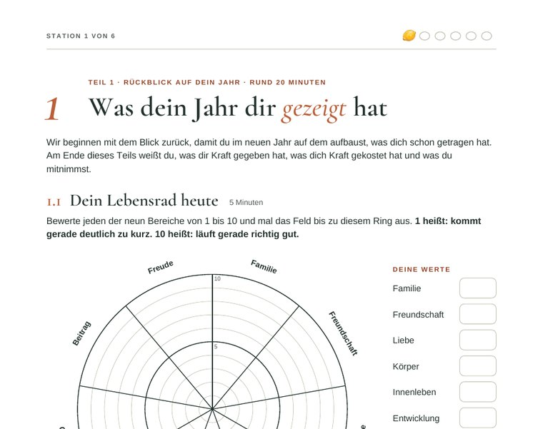

Ende des Jahres ist für viele von uns eine merkwürdige Zeit. Der Kalender ist voll, im Kopf läuft schon das nächste Jahr, und irgendwo dazwischen meldet sich die Frage, was dieses Jahr eigentlich mit dir gemacht hat und ob das nächste anders werden soll.

Viele beantworten das mit einer Liste guter Vorsätze, von der im Februar meist nicht mehr viel übrig ist. Ein persönlicher Jahresrückblick geht einen anderen Weg: Du schaust ehrlich zurück, damit du klarer siehst, wohin du willst, und du endest mit einem Schritt, der in deinen Alltag passt.

Hier findest du die Fragen, mit denen das gelingt.

## Wie bereitest du deinen Jahresrückblick vor?

Nimm dir zwei oder drei ruhige Abende, oder einen, wenn er lang genug ist. Leg dir deinen Kalender und dein Handy bereit, denn die Fotos der letzten zwölf Monate erinnern dich an mehr, als du gerade vielleicht im Kopf abrufen kannst.

Schreib mit der Hand oder tippe, beides funktioniert. Wichtig ist nur, dass du deine Antworten aufschreibst, weil das, was nur im Kopf bleibt, am nächsten Morgen oft schon wieder weg ist.

## Welche Fragen helfen beim Rückblick auf dein Jahr?

Hilfreich sind Fragen, die dir zeigen, worauf du im nächsten Jahr aufbauen kannst. Diese sieben führen dich durch dein Jahr.

**Wie zufrieden bist du gerade mit den einzelnen Bereichen deines Lebens?** Bewerte jeden der neun Bereiche im Lebensrad von 1 bis 10: Familie, Freundschaft, Liebe, Körper, Innenleben, Entwicklung, Geld, Beitrag und Freude. Schreib zu den zwei höchsten und den zwei niedrigsten Werten je einen Satz, was dahintersteht. So siehst du auf einen Blick, worauf du aufbauen kannst und wo sich am meisten bewegen soll. Eine ausführliche Anleitung mit Vorlage findest du im [Artikel zum Lebensrad](/ratgeber/lebensrad/).

*So sieht das Lebensrad im kostenlosen Journal aus.*

**Was ist in welchem Monat passiert?** Geh Monat für Monat durch und notiere zu jedem ein Ereignis, das dir im Gedächtnis geblieben ist. So bekommen auch die Monate Platz, die schon weit weg wirken.

**Was hat dir Kraft gegeben, und was hat dich Kraft gekostet?** Schreib je drei Menschen, Orte oder Tätigkeiten auf. Diese beiden Listen sind später Gold wert, wenn du entscheidest, wovon du im nächsten Jahr mehr und wovon du weniger willst.

**Wann ging es dir gut?** Denk an einen Moment, in dem du etwas selbst entschieden hast, obwohl es bequemer gewesen wäre, es anderen zu überlassen, an einen Moment, in dem du gemerkt hast, dass du etwas gut kannst, und an einen, in dem du dich mit jemandem verbunden gefühlt hast. Daraus liest du ab, unter welchen Bedingungen es dir gut geht.

**Worauf bist du stolz?** Notiere Momente, für die du dich überwinden musstest, und was du dann getan hast. In Wochen, in denen es im nächsten Jahr hakt, sind sie deine Belege, dass du dich überwinden kannst.

**Was lässt du zurück, und was nimmst du mit?** Schreib auf, welche Gewohnheit, welche Erwartung oder welcher Satz über dich nicht mit ins neue Jahr darf, und daneben, was bleiben soll.

**Welchen Titel gibst du diesem Jahr?** Stell dir vor, dein Jahr wäre ein Kapitel in einem Buch über dein Leben. Mit diesem einen Satz schließt du es ab, damit du mit freiem Kopf nach vorn schauen kannst.

## Welche Fragen helfen beim Ausblick auf das neue Jahr?

Für den Ausblick brauchst du Fragen, mit denen ein genaues Bild von dir in zwölf Monaten entsteht. Diese vier helfen dir dabei.

**Wie sieht ein ganz normaler Tag in zwölf Monaten aus?** Stell dir vor, es ist ein zufällig gewählter Montag, ein Jahr später, und du bist zufrieden damit, wie du lebst. Wo wachst du auf? Wie startest du in den Tag? Mit wem verbringst du deine Zeit und wie? Wie lässt du den Tag ausklingen? Was bringt dir Energie, wie erholst du dich, wie bewegst du dich?

Schreib in der Ich-Form und so genau wie möglich, denn je konkreter dein Bild wird, desto greifbarer wird das, worauf du zugehst.

**Wie willst du dich die meiste Zeit fühlen?** Wähle drei Wörter und schreib zu jedem auf, woran du im Alltag merkst, dass das Gefühl da ist. Daran kannst du später Entscheidungen und Termine messen.

**Wer willst du sein?** Das ist die wichtigste Frage. Schreib drei bis sieben Sätze, die mit „Ich bin jemand, der …“ beginnen. Zum Beispiel: „Ich bin jemand, der um 22 Uhr das Handy weglegt.“ Jeder Satz beschreibt etwas, das man an dir sehen könnte, und zusammen ergeben die Sätze deine Who-to-be-Liste.

**Was darf so bleiben, wie es ist?** Schreib mindestens drei Dinge auf, damit dein Plan auf dem aufbaut, was aus deinem jetzigen Leben dich schon zufrieden stimmt.

## Warum hält eine Who-to-be-Liste besser als ein Vorsatz?

Weil ein Satz wie „Ich bin jemand, der …“ aussagt, nach welchen Werten du dein Leben ausrichten und handeln möchtest, und ein kleiner Ausrutscher ändert daran so schnell nichts. Ein Vorsatz bezieht sich strikt auf Dinge, die du tun oder lassen willst. Wenn eines davon im vollen Alltag ausfällt, fühlt sich schnell der ganze Vorsatz erledigt an.

Die Psychologinnen Hazel Markus und Paula Nurius haben 1986 den Begriff der möglichen Selbstbilder geprägt (englisch „possible selves“). Gemeint sind unsere Vorstellungen davon, wer wir werden könnten, wer wir gern wären und wer wir auf keinen Fall werden wollen. Solche Bilder wirken als Antrieb: Wir bewegen uns auf die erhofften zu und von den befürchteten weg.

Wann das tatsächlich gelingt, hat Daphna Oyserman mit ihrem Team untersucht. In ihrer [Studie](https://dornsife.usc.edu/daphna-oyserman/wp-content/uploads/sites/232/2023/11/possible_selves_as_roadmaps.pdf) beschrieben 160 Jugendliche im Herbst ihres achten Schuljahres, wie sie sich im kommenden Jahr sahen und was sie dafür taten. Jugendliche, die zu ihrem Bild für die Schule auch konkrete Schritte nennen konnten, beteiligten sich im Frühjahr mehr am Unterricht, machten mehr Hausaufgaben, hatten bessere Noten und mussten seltener in den Förderunterricht der Sommerferien. Viele Zukunftsbilder ohne solche Schritte brachten dagegen keinen Unterschied. Genau darum geht es im letzten Teil.

*Im Journal landet deine Who-to-be-Liste auf einer Kompass-Seite, die dich durch das Jahr begleitet.*

## Wie kommst du vom Bild zum ersten Schritt?

Du planst von deinem Ziel aus rückwärts (im Englischen nett als ‚reverse-engineering‘ betitelt), bis du zu einem konkreten Schritt gelangst, den du innerhalb der nächsten 72 Stunden gehen könntest. Der psychologische Trick, wie wir die Umsetzung dieses Ziels deutlich wahrscheinlicher machen, ist, Hürden bereits mit einzukalkulieren. Ein schönes Bild von deiner Zukunft allein, in der du dir alle Träume erfüllt hast, reicht nämlich nicht und kann sich sogar negativ auf deine Handlungsfähigkeit auswirken. Die Psychologin Gabriele Oettingen hat [in ihrer Forschung gezeigt](https://www.psy.uni-hamburg.de/arbeitsbereiche/paedagogische-psychologie-und-motivation/personen/oettingen-gabriele/dokumente/oettingen-mayer-2002.pdf), dass reines Ausmalen das Handeln eher bremst. Es hilft, das Ziel mit den Hindernissen zu verbinden, die dir voraussichtlich begegnen.

**Plane rückwärts.** Dein Tag in zwölf Monaten ist das Ziel. Was muss in neun Monaten stehen, was in sechs, was in drei? Plane großzügiger, als es sich im ersten Moment anfühlt, weil fast alles länger dauert als anfangs gedacht.

*Die Rückwärtsplanung im Journal: von deinem Bild in 12 Monaten bis zu den nächsten vier Wochen.*

**Rechne mit Hindernissen.** Schreib zu jedem Bereich, in dem sich etwas bewegen soll, ein äußeres Hindernis auf, etwa Wochen voller Termine oder die Schulferien deiner Kinder, sowie ein mögliches inneres Hindernis, etwa einen Gedanken oder eine Gewohnheit, die dich oft ausbremst. Formuliere dann einen Wenn-dann-Plan: „Wenn [ich nach 21 Uhr noch Mails lese], dann [schalte ich mein Handy bis morgens in den Flugmodus].“ Solche Pläne helfen nachweislich, Vorhaben umzusetzen und Ziele zu erreichen, wie eine [Übersichtsarbeit von Peter Gollwitzer und Paschal Sheeran](https://kops.uni-konstanz.de/entities/publication/2e749bfb-8533-437c-8203-7e788c910c5f) zeigen konnte.

**Leg deinen ersten Schritt fest.** Wähle einen Schritt, der höchstens 30 Minuten dauert, und mach ihn in den nächsten 72 Stunden. Klein ist dabei Absicht, damit du merkst: Ich habe getan, was ich mir vorgenommen habe. Der nächste Schritt darf dann größer werden.

## Drei Stolpersteine

**Zu viel auf einmal.** Wähle höchstens drei Lebensbereiche, in denen sich im nächsten Jahr am meisten bewegen soll. So kommt deine Kraft dort an, wo sie am meisten bewirkt.

**Nur auf das schauen, was gefehlt hat.** Der Rückblick soll dir zeigen, worauf du aufbauen kannst. Fang deshalb immer mit dem an, was gut war.

**Auf die perfekten Antworten warten.** Deine Antworten dürfen vorläufig sein. Du kannst sie im Laufe des Jahres nachschärfen, und das ist sogar gewollt.
