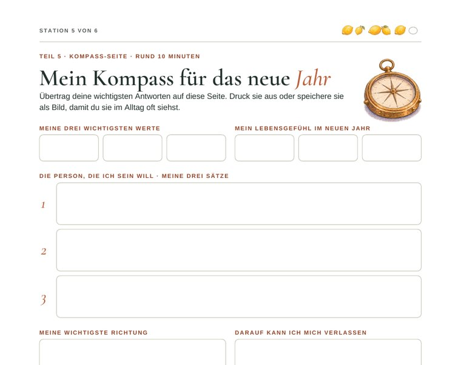

---
# Entwurf vom 25.11.2026 (Ratgeber Paket 1), Freigabe durch Christine offen.
# Quellen: Christines Erfahrungen und Who-to-be-Gedanke aus dem Chat vom 25.11.2026 (wörtlich nah übernommen),
# Journal „Wer will ich in 12 Monaten sein?“, Studien wie unter `quellen`. Beispielsätze unter „Welche Beispiele …“
# sind Vorschläge von Claude zur Freigabe. veroeffentlicht: beim Merge auf das echte Datum setzen.
titel: 'Neujahrsvorsätze, die halten: 5 Beispiele für deine Who-to-be-Liste'
seitentitel: 'Neujahrsvorsätze, die halten: 5 Beispiele'
kurztitel: 'Neujahrsvorsätze, die halten'
beschreibung: 'Warum gute Vorsätze so oft scheitern und was stattdessen hilft: eine Who-to-be-Liste mit Beispielen, ein Wenn-dann-Plan und ein erster Schritt für den Alltag.'
thema: jahresrueckblick
hauptbegriff: 'Neujahrsvorsätze'
veroeffentlicht: '2026-12-08'
lesezeit: 7
kurz:
  - 'Vorsätze scheitern oft, weil sie Listen sind: Der Alltag, widersprüchliche Ziele oder der Wunsch nach Erleichterung räumen sie ab.'
  - 'Eine Who-to-be-Liste beschreibt, wer du sein willst. Sie wirkt wie ein Kompass für viele Entscheidungen.'
  - 'Formuliere, was du tun willst. In einer großen Studie waren solche Vorsätze erfolgreicher als Vorsätze, etwas zu lassen.'
  - 'Ein ausgelassener Tag zählt kaum. Wichtig ist, dass du dich am nächsten Tag wieder ausrichtest.'
quellen:
  - titel: 'DAK-Gesundheit (2026): Vorsätze für das Jahr 2026. Repräsentative Forsa-Umfrage, 1.002 Befragte, 19. bis 21. November 2025.'
    url: 'https://www.dak.de/presse/bundesthemen/umfragen-studien/gute-vorsaetze-bei-jungen-menschen-im-trend_154232'
  - titel: 'Oscarsson, M., Carlbring, P., Andersson, G. & Rozental, A. (2020): A large-scale experiment on New Year’s resolutions: Approach-oriented goals are more successful than avoidance-oriented goals. PLOS ONE, 15(12), e0234097.'
    url: 'https://doi.org/10.1371/journal.pone.0234097'
  - titel: 'Lally, P., van Jaarsveld, C. H. M., Potts, H. W. W. & Wardle, J. (2010): How are habits formed: Modelling habit formation in the real world. European Journal of Social Psychology, 40(6), 998–1009.'
    url: 'https://core.ac.uk/download/70653523.pdf'
  - titel: 'Gollwitzer, P. M. & Sheeran, P. (2006): Implementation intentions and goal achievement: A meta-analysis of effects and processes. Advances in Experimental Social Psychology, 38, 69–119.'
    url: 'https://kops.uni-konstanz.de/entities/publication/2e749bfb-8533-437c-8203-7e788c910c5f'
  - titel: 'Dai, H., Milkman, K. L. & Riis, J. (2014): The fresh start effect: Temporal landmarks motivate aspirational behavior. Management Science, 60(10), 2563–2582.'
    url: 'https://doi.org/10.1287/mnsc.2014.1901'
verwandt:
  - 'jahresrueckblick-fragen'
  - 'lebensrad'
journalKarte:
  titel: 'Deine Who-to-be-Liste im Journal'
  text: 'Im kostenlosen Journal „Wer will ich in 12 Monaten sein?“ schreibst du deine Who-to-be-Liste auf eine Kompass-Seite und planst deinen ersten Schritt für die nächsten 72 Stunden.'
faq:
  - frage: 'Wie viele Vorsätze sollte ich mir für das neue Jahr vornehmen?'
    antwort: 'Wähle höchstens drei Lebensbereiche, in denen sich am meisten bewegen soll. Zu jedem schreibst du ein bis zwei Sätze, wer du dort sein willst. So bleibt genug Kraft für jeden einzelnen.'
  - frage: 'Muss ich mit meinen Vorsätzen bis zum 1. Januar warten?'
    antwort: 'Nein. Der Jahreswechsel ist ein guter Anlass, weil viele Menschen dann ohnehin Bilanz ziehen. Ein Geburtstag, ein Monatsanfang oder ein Jobwechsel taugen genauso als Startpunkt.'
  - frage: 'Was ist eine Who-to-be-Liste?'
    antwort: 'Eine Who-to-be-Liste besteht aus drei bis sieben Sätzen, die mit „Ich bin jemand, der …“ beginnen. Jeder Satz beschreibt etwas, das man an dir im Alltag sehen kann. Sie ersetzt die klassische Liste mit Vorsätzen.'
---

Neujahrsvorsätze halten länger, wenn du aufschreibst, wer du sein willst, und daraus einen kleinen Schritt für deinen Alltag ableitest. Eine Liste mit Dingen, die du dir vornimmst, übersteht den Februar selten. Ich habe das selbst erst nach vielen Jahren verstanden.

## Was sind typische Neujahrsvorsätze?

In Deutschland fassen rund vier von zehn Menschen gute Vorsätze für das neue Jahr. Das zeigt die jährliche Forsa-Umfrage für die DAK-Gesundheit. Für 2026 stand mehr Zeit für Familie und Freunde ganz oben (62 Prozent). Dahinter folgten weniger Stress (61 Prozent) und mehr Bewegung (57 Prozent). Mehr Zeit für sich selbst und gesünder essen nannte jeweils gut die Hälfte.

Die Rangfolge ändert sich von Jahr zu Jahr kaum. Viele nehmen sich also jedes Jahr wieder Ähnliches vor.

## Warum scheitern so viele Vorsätze?

Mein Körper und meine Gesundheit waren jahrelang mein Dauerthema (mich plagten als Jugendliche ein schwankendes Gewicht und Antriebslosigkeit). Gefühlt zwanzig Jahre lang hatte ich denselben Vorsatz: meine Gesundheit und meinen Körper in Ordnung bringen. Meine Gewohnheiten beim Essen und beim Sport änderten sich dabei kaum. Die guten Vorsätze sind jedes Jahr gescheitert. Rückblickend war das immer ein Hoffen und selten ein Tun.

Heute weiß ich, woran das lag. Eine Liste mit Vorsätzen hat starke Gegner:

- **Der volle Alltag.** Wenn die Woche eng wird, fällt zuerst weg, was noch nicht zur Routine geworden ist.
- **Widersprüchliche Ziele.** Du willst mehr Sport machen und gleichzeitig mehr Zeit für die Familie haben. Eines verliert.
- **Der Wunsch nach Erleichterung.** Nach einem langen Tag gewinnt das, was sich sofort gut anfühlt.

Und selbst wenn du etwas von deiner Liste streichen kannst, ist es damit erledigt. Danach kommt oft eine Leere, weil nichts mehr da ist, worauf du hinarbeitest.

## Was hat bei mir funktioniert?

Bei mir hat sich etwas verändert, als ich mich intensiv mit dem Thema beschäftigt und so viele Informationen gesammelt habe, wie ich konnte. Mit dem Wissen änderte sich meine Einstellung dazu, wie ich mit meinem Körper und meiner Gesundheit umgehe. Plötzlich konnte ich Dinge viel leichter im Alltag umsetzen. Erst wurden daraus Routinen, dann einfache Gewohnheiten, die sich festgesetzt haben.

Das beginnt bei kleinen Entscheidungen. Im Restaurant bestelle ich heute immer Wasser und keine Cola. Fruchtsaft trinke ich grundsätzlich nicht mehr. Ich esse gern Süßigkeiten, aber ich muss nicht. Und wenn etwas sehr gut schmeckt, kann ich aufhören, wenn ich satt bin.

Möglich wurde das durch einen Wandel in meiner Haltung mir selbst gegenüber: welcher Mensch ich bin und welches Selbstwertgefühl und Körpergefühl mir zusteht. Heute bin ich mit mir und meinem Verhältnis zu Essen und Körper sehr zufrieden.

## Warum trägt eine Who-to-be-Liste mehr als ein Vorsatz?

Eine Who-to-be-Liste beschreibt, wer du sein willst. Sie besteht aus Sätzen wie „Ich bin ein Mensch, der auf sich selbst achtgibt“ oder „Ich bin ein Mensch, der freundlich mit anderen umgeht“. Ein solcher Satz ist nie erledigt. Er wirkt wie ein Kompass, an dem du viele kleine Entscheidungen ausrichtest, vom Getränk im Restaurant bis zur Frage, ob du heute noch eine Runde spazieren gehst.

Wichtig ist, dass du formulierst, was du tun willst. In einer schwedischen Studie mit über 1.000 Teilnehmenden sahen sich Menschen, die etwas Neues anfangen wollten, nach einem Jahr häufiger als erfolgreich als Menschen, die etwas lassen wollten (58,9 gegenüber 47,1 Prozent). „Ich bin jemand, der im Restaurant Wasser bestellt“ trägt also weiter als „Ich trinke keine Cola mehr“.

*Im Journal kommt deine Who-to-be-Liste auf eine Kompass-Seite, die dich durch das Jahr begleitet.*

## Welche Beispiele gibt es für gute Vorsätze?

Nimm die häufigsten Vorsätze und schreib sie als Satz darüber, wer du sein willst. Jeder Satz beschreibt etwas, das man an dir sehen kann:

- **Statt „Mehr Zeit für Familie und Freunde“:** Ich bin jemand, der jede Woche eine Freundin oder einen Freund anruft.
- **Statt „Weniger Stress“:** Ich bin jemand, der mittags eine Pause ohne Bildschirm macht.
- **Statt „Mehr Sport“:** Ich bin jemand, der nach dem Abendessen eine Runde um den Block geht.
- **Statt „Mehr Zeit für mich“:** Ich bin jemand, der sich am Sonntagmorgen eine Stunde nur für sich nimmt.
- **Statt „Gesünder essen“:** Ich bin jemand, der zu jeder Mahlzeit Gemüse auf den Teller legt.

Drei bis sieben solcher Sätze reichen. Sie dürfen vorläufig sein. Du schärfst sie im Laufe des Jahres nach.

## Was tun, wenn du einen Tag auslässt?

Ein einziger Ausrutscher heißt nicht, dass du ein anderer Mensch bist oder gescheitert bist. Du richtest dich am nächsten Tag wieder danach aus, wonach du strebst und wer du sein möchtest.

Das passt zu dem, was die Forschung über Gewohnheiten weiß. In einer Studie am University College London brauchte eine neue Gewohnheit im Mittel 66 Tage, bis sie sich automatisch anfühlte, je nach Mensch zwischen 18 und 254 Tagen. Ein einzelner ausgelassener Tag hat den Aufbau dabei kaum gebremst.

## Wie kommst du vom Satz zum ersten Schritt?

Aus jedem Satz deiner Who-to-be-Liste machst du einen Wenn-dann-Plan: „Wenn ich vom Abendessen aufstehe, dann ziehe ich die Schuhe an und gehe eine Runde.“ Solche Pläne helfen nachweislich, Vorhaben umzusetzen. Das zeigt eine Übersichtsarbeit von Peter Gollwitzer und Paschal Sheeran über viele Studien.

Dann legst du einen ersten Schritt fest, der höchstens 30 Minuten dauert, und machst ihn in den nächsten 72 Stunden. Du musst dafür nicht bis Silvester warten. Forschende nennen das den Neuanfangseffekt: Ein Jahreswechsel, ein Geburtstag oder ein Monatsanfang machen es leichter, mit etwas Neuem zu beginnen. Jeder dieser Tage ist ein guter Startpunkt.
